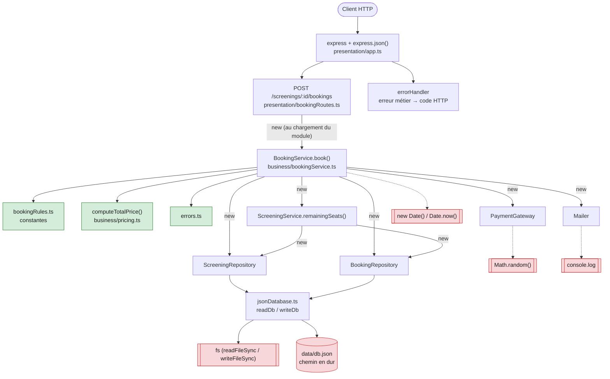

# Audit de `src/server.ts` (CinéResa legacy)

> Fichier audité : `src/server.ts` (151 lignes). Les numéros de lignes renvoient à la version actuelle du fichier (commit `ed2b574`).

Légende des responsabilités : **P** = Présentation · **M** = Règle métier · **D** = Accès aux données · **I** = Infrastructure. ⚠️ = plusieurs responsabilités mélangées.

## 1. Cartographie des responsabilités

### Socle

| Lignes | Bloc / fonction | Responsabilité | Commentaire |
|---|---|---|---|
| 3 | `import express` | P | Le framework HTTP est importé dans le même module que le métier. |
| 4-5 | `import fs`, `import path` | D | Le disque est utilisé directement, sans abstraction. |
| 7-8 | `express()`, `express.json()` | P | Création de l'application et parsing du JSON. |
| 10 | `DB_FILE` | D | Le chemin du fichier JSON est codé en dur. On ne peut pas pointer vers une base de test. |
| 12-14 | `readDb()` | D | Lecture synchrone de tout le fichier à chaque requête. Renvoie `any`. |
| 16-18 | `writeDb(db)` | D | Réécriture complète du fichier, sans verrou. |

### `GET /screenings` (l. 23-43)

| Lignes | Bloc / fonction | Responsabilité | Commentaire |
|---|---|---|---|
| 23 | Déclaration de la route | P | |
| 24 | `readDb()` | D | |
| 25 | `const now = new Date()` | I (temps) | L'horloge système est lue directement. |
| 27-28 | Filtre « séances à venir » | M | Règle « séance pas encore commencée » (`<` ici, alors que l. 64 utilise `<=`). |
| 29-32 | Calcul des places prises | M | Seules les réservations `CONFIRMED` sont comptées. Code dupliqué aux l. 69-72. |
| 33-40 | Construction de l'objet de réponse | ⚠️ P + M | Mise en forme d'un DTO. La l. 39 calcule en plus `remaining` (métier). |
| 42 | `res.json(result)` | P | |

### `POST /screenings/:id/bookings` (l. 49-107)

| Lignes | Bloc / fonction | Responsabilité | Commentaire |
|---|---|---|---|
| 49 | Déclaration de la route (`async`) | P | `async` alors qu'il n'y a aucun `await`. |
| 50-51 | `readDb()` et recherche de la séance | D | Recherche faite à la main dans le tableau. |
| 52 | 404 « Séance introuvable » | P | |
| 54-57 | Validation de l'e-mail | ⚠️ P + M | Le format est défini par une regex en ligne et la réponse est un 400 direct. |
| 59 | `Number(req.body.seats)` | P | Parsing de l'entrée. |
| 60-62 | Contrôle 1 à 6 places | ⚠️ M + P | Règle métier (`1`, `6` en dur) et réponse 400 au même endroit. |
| 64-66 | Contrôle « séance déjà commencée » | ⚠️ M + I + P | Règle métier, `new Date()` et réponse 409 au même endroit. |
| 69-75 | Contrôle de capacité | ⚠️ M + P | Calcul des places prises copié depuis les l. 29-32, puis réponse 409. |
| 78-81 | Calcul du prix | M | -30 % étudiant, -10 % dès 4 places, arrondis. Aucune fonction dédiée. |
| 84-85 | Paiement simulé | ⚠️ I + P | `Math.random() > 0.05` joue le rôle du prestataire, puis réponse 402. |
| 87-96 | Construction de la réservation | ⚠️ M + I | Statut initial et normalisation du tarif (l. 92) côté métier. `Date.now()` (l. 88) et `new Date()` (l. 95) côté infra. |
| 97-98 | `push` puis `writeDb(db)` | D | |
| 101-104 | Mail de confirmation | I (mail) | `console.log` sert de faux SMTP. Formatage du prix en € fait dans ce bloc. |
| 106 | `res.status(201).json(booking)` | P | Renvoie l'objet de persistance tel quel. |

### `DELETE /bookings/:id` (l. 112-130)

| Lignes | Bloc / fonction | Responsabilité | Commentaire |
|---|---|---|---|
| 112 | Déclaration de la route | P | |
| 113-114 | `readDb()` et recherche de la réservation | D | |
| 115 | 404 « Réservation introuvable » | P | |
| 116 | Contrôle « déjà annulée » | ⚠️ M + P | Règle métier et réponse 409. |
| 118 | Recherche de la séance | D | Pas de contrôle si `s` est `undefined` : plantage à la l. 119 (erreur 500). |
| 119-122 | Règle des 2 h | ⚠️ M + I + P | Calcul `2 * 60 * 60 * 1000`, `new Date()` et réponse 409 au même endroit. |
| 124-125 | Passage à `CANCELLED` | ⚠️ M + I | L'état est modifié directement sur l'objet. `new Date()` à la l. 125. |
| 126 | `writeDb(db)` | D | |
| 128 | Mail d'annulation | I (mail) | `console.log`, avec un formatage € dupliqué depuis la l. 103. |
| 129 | `res.json(b)` | P | |

### `GET /bookings?email=...` (l. 135-144)

| Lignes | Bloc / fonction | Responsabilité | Commentaire |
|---|---|---|---|
| 135 | Déclaration de la route | P | |
| 136-137 | `readDb()` et filtre par e-mail | ⚠️ D + P | `req.query.email` est utilisé tel quel, sans validation. |
| 139-143 | Jointure avec la séance et mapping | ⚠️ D + P | Jointure faite à la main, puis DTO avec un repli `"?"` / `null`. |

### Démarrage

| Lignes | Bloc / fonction | Responsabilité | Commentaire |
|---|---|---|---|
| 146 | `PORT` | I (config) | Lecture de `process.env`. |
| 147-149 | `app.listen` | I / P | Le serveur ne démarre que si le fichier est exécuté directement. |
| 151 | `export default app` | P | Permet de tester via HTTP (supertest), mais seulement l'application entière. |

## 2. Code smells

| # | Smell (nom standard) | Lignes | Description | Conséquence concrète |
|---|---|---|---|---|
| 1 | **God Object / Large Class** (ici, un fichier unique) | 1-151 | Routes HTTP, règles métier, persistance, mail, paiement, horloge et démarrage sont tous dans un seul module. | Toute évolution (ajouter un tarif, passer sur une vraie base, brancher un vrai SMTP) touche ce même fichier. Aucune partie n'est réutilisable ni testable seule. |
| 2 | **Long Method** | 49-107 | Le handler POST fait 59 lignes et enchaîne parsing, 4 validations, calcul du prix, paiement, persistance, mail et réponse. | Pour tester la remise groupe, il faut passer par HTTP, une séance réelle dans `db.json`, un e-mail valide et un paiement qui réussit. |
| 3 | **Duplicated Code** | 29-32 / 69-72 ; 51 / 118 / 140 ; 103 / 128 | Le calcul des places prises est copié-collé (le commentaire de la l. 68 le reconnaît). La recherche d'une séance par id est écrite 3 fois. Le formatage `(x / 100).toFixed(2) €` est écrit 2 fois. | Si une réservation « en attente de paiement » doit aussi bloquer des places, il faut modifier 2 boucles. En oublier une affiche des places restantes fausses ou autorise du surbooking. |
| 4 | **Magic Numbers** | 60, 79, 81, 84, 120 | Les valeurs `1`, `6`, `0.7`, `4`, `0.9`, `0.05` et `2 * 60 * 60 * 1000` sont en dur, sans nom. | Pour passer la remise étudiant à -25 % ou le délai d'annulation à 24 h, il faut retrouver la valeur dans le code. Rien n'indique que `0.7` veut dire « -30 % étudiant ». |
| 5 | **Primitive Obsession** / absence de modèle (`any`) | 12, 16, 31, 79, 92, 94, 116, 124 | Séance et réservation sont des objets `any`. Statuts et tarifs sont des chaînes libres (`"CONFIRMED"`, `"STUDENT"`). Le prix est un `number` sans notion de centimes. L'e-mail est une `string`. | Une faute de frappe (`"CONFIRMD"`) compile sans erreur. Un tarif inconnu (`"ENFANT"`) devient `NORMAL` sans rien signaler (l. 79 et 92). Le compilateur ne garantit aucun invariant. |
| 6 | **Couplage fort au temps** | 25, 28, 64, 88, 95, 119, 125 | `new Date()` et `Date.now()` sont appelés directement, 7 fois. | Impossible de tester la règle des 2 h ou le refus d'une séance commencée sans modifier les dates dans `db.json` ou attendre. Les tests dépendent de l'heure à laquelle on les lance. |
| 7 | **Couplage fort au disque** (pas d'abstraction de persistance) | 10-18, 24, 50, 98, 113, 126, 136 | Chaque route lit et réécrit tout `data/db.json` avec `fs`, de façon synchrone. | Chaque test modifie le vrai `db.json` (le fichier est d'ailleurs déjà modifié dans le dépôt). Passer sur SQL ou Mongo demande de réécrire les 4 routes. |
| 8 | **Couplage à l'aléatoire et dépendances cachées** (paiement et mail) | 84, 88, 101-104, 128 | Le paiement est un `Math.random()` qui échoue dans 5 % des cas. Le mail est un `console.log` écrit dans le handler. | Un test du POST échoue au hasard 1 fois sur 20 (402). Impossible de vérifier qu'un mail est « envoyé » sans intercepter la console. `"b" + Date.now()` peut produire deux fois le même id pour deux réservations dans la même milliseconde. |
| 9 | **Shotgun Surgery** | 31, 71, 94, 116, 124 | La notion de statut de réservation et le calcul de disponibilité sont dispersés dans plusieurs routes. | Ajouter un statut (ex. `PENDING`) oblige à modifier GET /screenings, POST et DELETE. |
| 10 | **Règles incohérentes et cas non gérés** (conséquence de la duplication) | 28 vs 64 ; 118-119 | Une séance « commencée » est testée avec `<` à un endroit et `<=` à l'autre. La séance absente n'est pas gérée dans DELETE, alors qu'elle l'est dans GET /bookings (l. 141). | À l'instant exact du début, une séance apparaît encore comme disponible dans GET mais la réservation est refusée par POST. Une réservation orpheline fait planter DELETE (500). |

## 3. Violations SOLID (S, O, L, I, D)

> Analyse du code legacy (`src/server.ts` au commit `ed2b574`, mêmes numéros de lignes que les sections 1 et 2).

| Lettre | Violation ? | Où | Explication |
|---|---|---|---|
| **S** (Single Responsibility) | Oui | 49-107 (et le fichier entier) | Le handler POST a au moins 5 raisons de changer : le format HTTP, les règles de réservation, la grille tarifaire, le stockage (`fs`) et le prestataire de mail ou de paiement. Une modification de la remise groupe et un passage à PostgreSQL touchent la même fonction. |
| **O** (Open/Closed) | Oui | 79, 92 ; 101-104 | Ajouter un tarif (ex. `SENIOR`) oblige à modifier les `if` / ternaires des l. 79 et 92. Ajouter un canal de notification (SMS) oblige à modifier le handler. Rien ne permet d'étendre le comportement sans éditer le code existant. |
| **L** (Liskov Substitution) | Ne s'applique pas | — | Le code ne contient ni classe, ni héritage, ni interface : il n'y a aucun sous-type qui pourrait mal se substituer à son parent. Le principe deviendra pertinent au TP2, quand on fournira un faux `PaymentGateway` ou un dépôt en mémoire : ils devront respecter le même contrat que l'implémentation réelle. |
| **I** (Interface Segregation) | Ne s'applique pas au sens strict | 12-18 | Aucune interface n'est déclarée, donc aucune interface « trop grosse ». On voit cependant le problème que l'ISP prévient : `readDb()` renvoie toute la base (séances et réservations) à chaque route, même à `GET /bookings` qui n'a besoin que des réservations d'un client. |
| **D** (Dependency Inversion) | Oui | 13, 17, 25, 64, 84, 101, 128 | Les règles métier (haut niveau) dépendent directement de détails techniques (bas niveau) : `fs.readFileSync` / `writeFileSync`, `new Date()`, `Math.random()`, `console.log`. Aucune abstraction entre les deux. Le découpage en couches ne corrige pas encore ce point : `BookingService` fait lui-même `new PaymentGateway()`, `new Mailer()`, etc. (`src/business/bookingService.ts:30-34`). |

## 4. Graphe des dépendances de POST /screenings/:id/bookings

> Code actuel, après le découpage en couches. Flèche pleine : instanciation (`new`) ou import. Flèche pointillée : appel à une fonction globale.

En vert, le code pur (aucun effet de bord). En rouge, les dépendances non déterministes ou à effet de bord.

## 5. Dépendances remplaçables en test ?

« Sans modifier le code » = sans toucher à `src/`. On distingue deux cas : **par conception**, quand le code prévoit un point de substitution (paramètre, constructeur), et **par contournement**, quand on écrase un global ou un module depuis le test (`vi.mock`, `vi.spyOn`, `vi.useFakeTimers`).

| Dépendance | Utilisée dans | Remplaçable par conception ? | Contournement possible | Verdict |
|---|---|---|---|---|
| Serveur HTTP (port) | `server.ts` | Oui : `app` est exporté et `listen` n'est appelé que si le fichier est lancé directement | — | **Oui**, avec supertest sur `app`, sans ouvrir de port. |
| `BookingService` | `bookingRoutes.ts:6` | Non : instancié au chargement du module | `vi.mock("../src/business/bookingService")` | **Non** proprement. |
| `ScreeningRepository`, `BookingRepository` | `bookingService.ts:30-31`, `screeningService.ts` | Non : `new` dans les champs privés | `vi.mock` des modules data | **Non** proprement. |
| `fs` + `data/db.json` | `jsonDatabase.ts:34, 38` | Non : chemin `DB_FILE` en dur, aucun paramètre | `vi.mock("fs")`, ou écrire un vrai `db.json` de test (et le restaurer après) | **Non** : les tests écrivent dans le vrai fichier du dépôt ou dépendent d'un mock global fragile. |
| `PaymentGateway` / `Math.random()` | `bookingService.ts:33`, `paymentGateway.ts:8` | Non | `vi.spyOn(Math, "random")` | **Non** proprement : sans contournement, un test sur 20 échoue au hasard (402). |
| `Mailer` / `console.log` | `bookingService.ts:34`, `mailer.ts` | Non | `vi.spyOn(console, "log")` | **Non** proprement : la seule façon de vérifier l'envoi est d'intercepter la console. |
| `new Date()` / `Date.now()` | `bookingService.ts:51, 66, 74` | Non : l'heure n'est jamais passée en paramètre | `vi.useFakeTimers()` + `vi.setSystemTime()` | **Non** proprement : sans contournement, les tests dépendent de l'heure d'exécution. |
| `computeTotalPrice` | `pricing.ts` | Pas besoin : fonction pure | — | **Oui**, testée directement (`test/pricing.test.ts`). |
| Constantes (`bookingRules.ts`, `pricing.ts`) | — | Pas besoin : valeurs fixes | — | **Oui**. |

Conclusion : seules les parties sans dépendance (fonction pure, constantes) et l'application Express entière sont utilisables telles quelles en test. Tout le reste ne se remplace qu'en écrasant des modules ou des globaux, ce qui couple les tests aux détails d'implémentation. L'injection de dépendances (TP2) supprimera ce problème.

## 6. Bilan : ce qui est testable / intestable

### Testable sans serveur ni `db.json`

| Règle métier | Comment | Pourquoi c'est possible |
|---|---|---|
| Tarif étudiant -30 % | `computeTotalPrice(…, "STUDENT")` | Fonction pure : le résultat dépend uniquement des paramètres. |
| Remise groupe -10 % dès 4 places | `computeTotalPrice(…, 4, …)` | Idem. |
| Arrondis au centime et cumul des deux remises | `computeTotalPrice` | Idem. Couvert par 7 tests dans `test/pricing.test.ts`. |
| Calcul des places restantes | `new ScreeningService().remainingSeats(screening, bookings)` | La méthode reçoit la séance et les réservations en paramètres. Le constructeur crée des dépôts, mais ils ne lisent le disque que si on les appelle. Pas encore de test écrit. |

### Intestable (sans serveur ou sans `db.json`)

| Règle métier | Où | Pourquoi |
|---|---|---|
| 1 à 6 places par réservation | `BookingService.book()` | La logique est simple, mais elle s'exécute après `screeningRepository.findById()` : il faut une séance dans `db.json` pour l'atteindre. |
| Format de l'e-mail | `BookingService.book()` | Même raison. |
| Refus d'une séance déjà commencée | `BookingService.book()` | Dépend de `new Date()` et d'une séance lue dans `db.json`. |
| Capacité de la salle | `BookingService.book()` | Les réservations existantes sont lues dans `db.json`. |
| Paiement refusé (402) | `BookingService.book()` | `PaymentGateway` est créé par le service et repose sur `Math.random()`. |
| Enregistrement et envoi du mail de confirmation | `BookingService.book()` | Écrit dans le vrai `db.json` et passe par `console.log`. |
| Annulation jusqu'à 2 h avant | `BookingService.cancel()` | Dépend de `new Date()` et de `db.json`. |
| Annulation refusée si déjà annulée | `BookingService.cancel()` | Dépend de `db.json`. |
| Liste des séances à venir | `ScreeningService.listUpcoming()` | Dépend de `new Date()` et de `db.json`. |
| Réservations d'un client avec film et date | `BookingService.listByEmail()` | Dépend de `db.json`. |

**Cause commune :** les services créent eux-mêmes leurs dépendances (`new` dans les champs) et appellent directement des fonctions globales (`new Date()`, `Math.random()`, `console.log`, `fs`). Aucun point d'entrée ne permet de leur fournir une horloge fixe, un paiement prévisible ou des données en mémoire.

**Pistes pour le TP2 :** injecter les dépôts, le paiement et le mailer par le constructeur derrière des interfaces, et injecter aussi une horloge (`Clock`) et un générateur d'id. Toutes les règles du second tableau deviendront alors testables avec des faux en mémoire.
