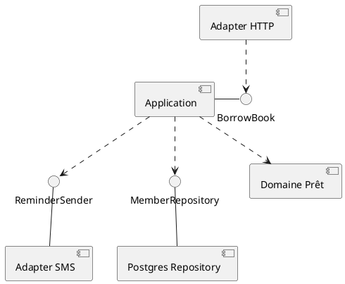
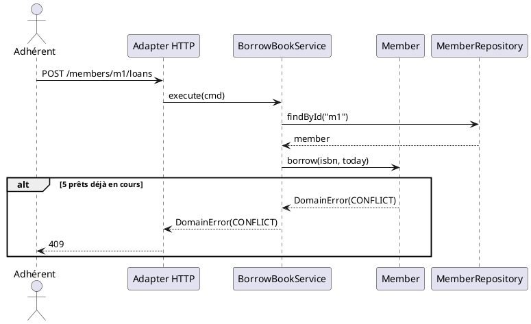

# Document d'architecture technique — CinéResa

> Binôme : <noms> · Version : <x.y> · Date : <jj/mm/aaaa>
>
> Les blocs « Exemple » portent sur un **autre domaine** (une médiathèque qui prête des livres) pour montrer le niveau de détail attendu. Supprimez-les dans votre version.

---

## 1. Contexte et objectifs

**À décrire** : le besoin, les utilisateurs, le périmètre, ce qui est explicitement **hors périmètre**.

> Exemple — API de prêt pour un réseau de 4 médiathèques. Utilisateurs : adhérents (web, mobile), bibliothécaires. Hors périmètre : achat des ouvrages, catalogue (outil existant).

## 2. Contraintes et exigences

**À décrire** : au moins un scénario de qualité complet.

| Élément | Votre scénario |
|---|---|
| Source | … |
| Stimulus | … |
| Environnement | … |
| Artefact | … |
| Réponse | … |
| Mesure | … |

> Exemple — Source : 300 adhérents · Stimulus : prolongent leurs prêts la veille des vacances · Environnement : production, pic · Artefact : API de prêt · Réponse : chaque prolongation est acceptée ou refusée, aucune perdue · Mesure : 95 % en moins de 1 s.

## 3. Glossaire

| Terme du métier | Définition | Nom dans le code |
|---|---|---|
| … | … | … |

> Exemple — Prêt : un livre emprunté par un adhérent pour 3 semaines · `Loan`.

## 4. Vue logique

### 4.1 Style d'architecture

<couches / hexagonale / hexagonale + DDD tactique, et pourquoi (renvoyer vers l'ADR)>

### 4.2 Diagramme de composants UML



## 5. Vue dynamique : un cas d'erreur



## 6. Décision d'architecture

| ADR | Titre | Statut |
|---|---|---|
| [001](adr/001-....md) | Booking dans l'agrégat Screening ou agrégat séparé ? | … |

Modèle d'ADR (`docs/adr/001-titre.md`) :

```markdown
# ADR-00X : <titre>
Statut : proposé | accepté | remplacé par ADR-00Y — <date>

## Contexte
<la situation, les forces en présence>

## Options envisagées
1. …
2. …

## Décision
<l'option retenue>

## Conséquences
+ …
- …
```
