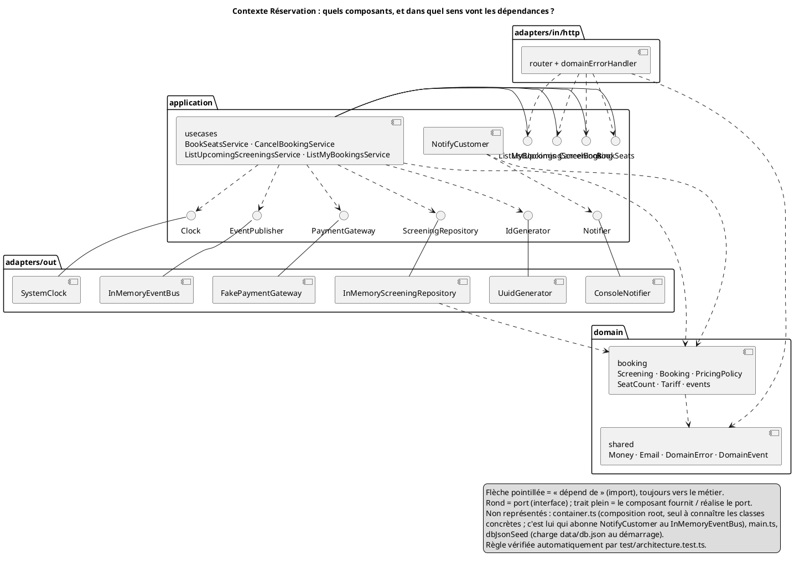
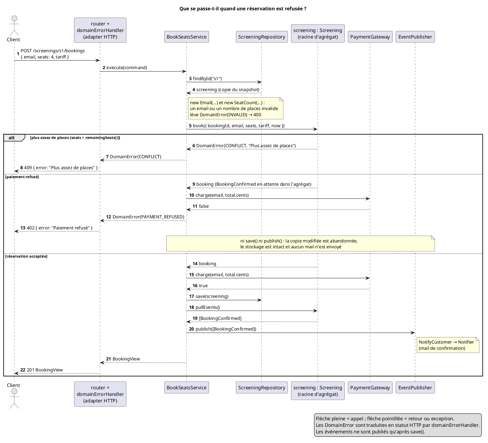

# Document d'architecture technique — CinéResa

> Binôme : ABOU KHECHFE YEHYA  , NGANGA IVANA TITIA
> Date : 09/11/2026
>
> Ce document décrit le code du dépôt à l'issue du TP4 (`src/`). Les noms utilisés ici, dans le glossaire, dans les diagrammes et dans le code sont les mêmes.

---

## 1. Contexte et objectifs

**Besoin.** CinéResa est une API REST de réservation de places de cinéma. Un client consulte les séances à venir et les places restantes, réserve de 1 à 6 places, paie, puis peut annuler jusqu'à 2h avant la séance. Il reçoit un e-mail de confirmation, puis de remboursement s'il annule.

**Utilisateurs.** Les spectateurs, à travers un front web ou mobile qui appelle l'API.

**Périmètre.**

| Méthode | Route | Cas d'usage |
|---|---|---|
| GET | `/screenings` | lister les séances à venir avec les places restantes (`ListUpcomingScreenings`) |
| POST | `/screenings/:id/bookings` | réserver des places, tarif `NORMAL` ou `STUDENT` (`BookSeats`) |
| DELETE | `/bookings/:id` | annuler une réservation (`CancelBooking`) |
| GET | `/bookings?email=…` | consulter ses réservations (`ListMyBookings`) |

**Hors périmètre.**
- **Programmation :** les séances et les films ne sont pas gérés par l'API. Ils sont chargés au démarrage depuis `data/db.json`, généré par `npm run seed`.
- **Fonctions absentes :** pas de choix de sièges numérotés, pas d'authentification.
- **Services simulés :** le paiement (`FakePaymentGateway`) et l'envoi d'e-mails (`ConsoleNotifier`) sont simulés.
- **Persistance :** elle est en mémoire seulement, et `db.json` n'est jamais réécrit.

**Contraintes.**
- **Technique :** TypeScript et Express.
- **Contrat HTTP :** routes, codes et corps JSON doivent rester ceux de la version legacy de départ.
- **Montants :** tous en centimes.

## 2. Contraintes et exigences

Scénario de qualité : **intégrité des réservations** (la capacité n'est jamais dépassée, et un refus ne laisse aucune trace).

| Élément | Votre scénario |
|---|---|
| Source | Un client de CinéResa |
| Stimulus | Il demande à réserver *n* places sur une séance où il en reste moins de *n*, ou bien son paiement est refusé par le prestataire |
| Environnement | Fonctionnement normal, séance presque complète |
| Artefact | Le cas d'usage `BookSeats` (`BookSeatsService`) et la racine d'agrégat `Screening` |
| Réponse | La demande est refusée : 409 « Plus assez de places » ou 402 « Paiement refusé ». Aucune réservation n'est enregistrée, aucun événement n'est publié et aucun e-mail n'est envoyé. Pour un manque de places, aucun paiement n'est même demandé |
| Mesure | 0 séance en surréservation (`remainingSeats()` ≥ 0 en toutes circonstances). 100 % de ces cas sont couverts par des tests automatiques (`test/Screening.test.ts`, `test/BookSeatsService.test.ts`) qui passent à chaque `npm test` |

Limite connue : la mesure suppose que deux réservations sur une même séance ne s'entrelacent pas (voir les conséquences de l'[ADR-001](adr/001-booking-dans-agregat-screening.md)).

## 3. Glossaire

| Terme du métier | Définition | Nom dans le code |
|---|---|---|
| Séance | Projection d'un film dans une salle, à une date, avec une capacité et un prix unitaire. Seule porte d'entrée pour réserver et annuler | `Screening` |
| Réservation | Des places réservées par un client sur une séance, avec un tarif et un total | `Booking` |
| Statut de réservation | Confirmée à la création, annulée ensuite (une seule fois) | `BookingStatus` (`CONFIRMED`, `CANCELLED`) |
| Nombre de places | Entier de 1 à 6 par réservation | `SeatCount` |
| Groupe | Réservation d'au moins 4 places, qui bénéficie de -10 % | `SeatCount.isGroup()` |
| Tarif | Normal ou étudiant (-30 % sur le prix unitaire) ; tout autre tarif est traité comme normal | `Tariff` (`NORMAL`, `STUDENT`) |
| Montant | Somme en centimes, jamais négative | `Money` |
| E-mail du client | Adresse normalisée (minuscules, sans espaces) et valide | `Email` |
| Politique de prix | Calcul du total : tarif étudiant, puis remise groupe, arrondis au centime | `PricingPolicy` |
| Places restantes | Capacité moins les places des réservations confirmées | `Screening.remainingSeats()` |
| Délai d'annulation | On ne peut plus annuler à moins de 2h de la séance | `Screening.CANCELLATION_DEADLINE_HOURS` |
| Réservation confirmée / annulée | Faits métier émis par la séance, qui déclenchent les e-mails | `BookingConfirmed`, `BookingCancelled` |
| Erreur métier | Refus d'une règle, avec un code traduit en statut HTTP | `DomainError` (`NOT_FOUND`, `INVALID`, `CONFLICT`, `PAYMENT_REFUSED`) |

## 4. Vue logique

### 4.1 Style d'architecture

**Architecture hexagonale (ports et adapters) avec DDD tactique**, en trois cercles :
- **`src/domain/` :** le modèle riche, sans aucune dépendance technique.
  - `booking/` : la racine d'agrégat `Screening`, l'entité `Booking`, le domain service `PricingPolicy`, les value objects `SeatCount` et `Tariff`, et les domain events.
  - `shared/` : `Money`, `Email`, `DomainError` et `DomainEvent`.
- **`src/application/` :** les ports entrants (`ports/in`, avec les DTO renvoyés comme `BookingView`), les ports sortants (`ports/out`), les quatre use cases (`usecases/`) et le handler `NotifyCustomer` (`handlers/`).
- **`src/adapters/` :** l'adapter entrant HTTP (Express) et les adapters sortants (mémoire, bus d'événements, paiement, e-mails, horloge, identifiants).

`src/container.ts` est la **composition root** : c'est le seul fichier qui instancie les adapters et abonne `NotifyCustomer` aux événements.

**Pourquoi ce style ?**
- **Règles métier testables seules :** les règles de capacité, de prix et d'annulation se testent sans HTTP ni stockage.
- **Adapters remplaçables :** on change la persistance ou le paiement en ne touchant qu'un adapter et le `container`.
- **Mails découplés :** l'envoi des e-mails réagit aux événements au lieu d'être appelé par les use cases.
- **Racine d'agrégat :** le choix de faire de `Screening` la racine est justifié dans l'[ADR-001](adr/001-booking-dans-agregat-screening.md).

**Contrôle automatique.** La règle de dépendance est vérifiée à chaque `npm test` par `test/architecture.test.ts` : le domaine n'importe ni l'application, ni les adapters, ni une librairie technique, et l'application n'importe aucun adapter.

### 4.2 Diagramme de composants UML

Question : *quels composants forment le contexte Réservation, et dans quel sens vont leurs dépendances ?*
Source : [`diagrams/composants.puml`](diagrams/composants.puml).

**Lecture.** Toutes les flèches de dépendance vont vers l'application et le domaine.
- **Ports entrants :** l'adapter HTTP ne connaît que ces interfaces.
- **Ports sortants :** l'application déclare ceux dont elle a besoin, et les adapters de `adapters/out` les réalisent.
- **Domaine :** il ne dépend de rien, sauf de son propre noyau `shared`.

## 5. Vue dynamique : un cas d'erreur

Question : *que se passe-t-il quand une réservation est refusée ?*
Source : [`diagrams/sequence-reservation-refusee.puml`](diagrams/sequence-reservation-refusee.puml).

**Lecture.** Une réservation est refusée à deux endroits :
- **Dans l'agrégat :** il ne reste pas assez de places (409). Rien n'a encore été payé.
- **Après l'agrégat :** le paiement est refusé (402).

Dans les deux cas, le use case s'arrête avant `save()` et `publish()`. Le repository stocke des copies : la séance modifiée en mémoire est donc abandonnée sans effet sur le stockage, et aucun événement ne part. Aucun e-mail n'est envoyé.

## 6. Décision d'architecture

| ADR | Titre | Statut |
|---|---|---|
| [001](adr/001-booking-dans-agregat-screening.md) | Booking dans l'agrégat Screening ou agrégat séparé ? | accepté |
